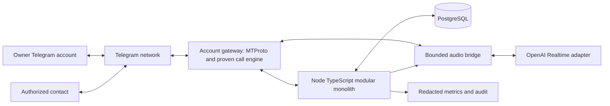

# Personal AI Executive Assistant — Technical Specification

Version: 1.0 • Prepared: 15 October 2026 • Language: English

Status: implementation baseline; Telegram private-call media feasibility is **UNVERIFIED**.

## 1. Purpose, source, and interpretation

Build a personal executive assistant operated through Telegram, using a dedicated Telegram user account. It must manage the owner's tasks and reminders, call the owner, hold live voice conversations, and call explicitly authorized business contacts on the owner's behalf. It must disclose its AI identity, ask permission to continue, discuss only the assigned subject, and report outcomes and proposed follow-up work.

The requirements source is the Uzbek conversation **“AI yordamchi imkoniyatlari”**, conversation ID `6ace389b-a42c-83ed-923e-437e8ac14993`. The retrievable conversation includes the user's requirements and a BRD introduction, but **does not include the complete Uzbek BRD artifact**. This specification reconstructs the confirmed requirements from those messages; it does not claim to translate an unavailable document. Engineering defaults below are proposed implementation decisions, not additional user commitments. Reconcile any subsequently supplied BRD through a documented requirements diff.

Confirmed context: the owner prefers Node.js or a comparable practical implementation; the selected baseline is Node.js + TypeScript. The owner reported that Twilio registration was unsuitable in Uzbekistan and requested a separate Telegram number/account. Treat that as the owner's constraint, not a verified claim about Twilio's country availability.

### 1.1 Requirement traceability

| ID | Requirement | Origin | Verification |
|---|---|---|---|
| R01 | Dedicated assistant Telegram user account | Explicit owner request | Secure login and account-identity test |
| R02 | Real private Telegram calls that ring the owner's phone | Explicit owner request | Phase 0 physical-device test |
| R03 | Bidirectional live AI voice conversation | Conversation's V3 objective | Media and Realtime end-to-end test |
| R04 | Tasks, persistent reminders, and voice-driven changes | Conversation's assistant workflow | Restart and task-mutation tests |
| R05 | Calls to owner-specified business contacts | Explicit owner request | Permission and contact-call tests |
| R06 | Discuss assigned issues, ask follow-up questions, report results | Explicit owner request and accepted workflow | Scenario evaluation |
| R07 | Disclose AI identity and seek consent | Source workflow | Consent and identity tests |
| R08 | Node.js + TypeScript, PostgreSQL, modular boundaries | Engineering baseline consistent with discussion | Build, migration, architecture review |
| R09 | Verify private-call media before promising delivery | Source technical caveat and current request | Feasibility evidence gate |
| R10 | Secure sessions, permissions, audit trail, recovery | Engineering requirements for reliable operation | Security and fault tests |

### 1.2 Scope and boundaries

Initial release: one owner, one assistant account, Uzbek-first interactions, English supported, one concurrent call, text and voice-note input, daily briefings, task CRUD, one-off/recurring reminders, approved business-call agendas, reports, and limited owner-controlled memory. Russian is optional after language evaluation. Default timezone is `Asia/Samarkand`; every scheduling confirmation includes the local date, time, and timezone.

Excluded initially: PSTN/SIM calling, Twilio, group voice chats as a substitute for private calls, video, mass outreach, autonomous financial or contractual commitments, impersonation, arbitrary shell/browser tools, calendar/email integrations, and multi-owner tenancy. A Mini App or voice-note fallback is a separate mode and must never be described as a real Telegram call.

## 2. Product workflows

### 2.1 Owner task and reminder

1. Owner sends text or a voice note: “Remind me tomorrow at nine to review the credit workflow.”
2. Authenticate using the numeric Telegram sender ID and private-chat context. Transcribe voice notes through a provider adapter; mark transcription as uncertain when appropriate.
3. Resolve dates against the message's original receipt time and owner timezone. Ask a concise clarification for ambiguous time, identity, or destructive action.
4. Save task, reminder, and outbox event transactionally. Confirm the exact interpreted schedule after commit.
5. At the due time, send a message and, if separately enabled by an owner policy, initiate a call. When calling is disabled or unverified, use an explicitly labeled message reminder.
6. Owner can say “Move the second task to tomorrow.” Resolve “second” against the current briefing snapshot, then apply optimistic concurrency and confirm the new date.

### 2.2 Owner briefing call

An owner-configured schedule authorizes calls to the owner's verified account. Prepare a bounded briefing of overdue and upcoming tasks. After answer, identify as the AI assistant; use the owner's recorded opt-in or obtain consent as configured. Accept task commands only within the authenticated owner call. The owner can interrupt, cancel, or say “stop calling me.” Respect quiet hours and the kill switch.

### 2.3 Delegated business call

Example assignment: “Call Javlon. Find out whether today's credit-workflow errors are fixed. If not, ask what is blocking the fix and when it will be ready. Report back.”

Resolve Javlon to a verified numeric Telegram ID. Prepare an immutable call brief: recipient, purpose, allowed facts, questions, limits, expiry, and maximum duration. An explicit owner instruction can authorize the exact brief immediately; do not demand a redundant confirmation. If target, scope, or time is ambiguous, show the concrete brief for clarification. A contact allowlist alone is not authorization for an arbitrary call.

At answer, play a deterministic introduction: “Hello, I am [owner]'s AI assistant calling about [approved topic]. This conversation uses an AI service to process speech. May we continue?” Before consent, keep contact audio within the local consent subsystem; do not forward it to OpenAI or save a business transcript. Use a verified on-device consent recognizer or another explicitly approved local mechanism. Unknown/ambiguous responses mean no consent. If reliable local recognition cannot be demonstrated, third-party voice calls remain disabled until an approved alternative consent mechanism is implemented.

After consent, ask the approved questions, clarify uncertain answers, and politely end the call. If consent is refused or withdrawn, stop the discussion, purge queued audio, and disconnect. The contact cannot authorize new calls, access the owner's memory, or grant themselves owner privileges.

Send the owner a report containing status, answers, blockers, stated deadlines, unresolved questions, and proposed tasks. Attribute statements to the contact and distinguish claims from verified facts. Create follow-up tasks automatically only under an explicit owner policy; otherwise save proposals for approval. Do not promise deadlines on the owner's behalf without authority.

## 3. Verified integration facts and feasibility gate

### 3.1 Telegram: signaling is not media

Telegram documents private one-to-one calling through MTProto. `phone.requestCall` is available to user accounts and can fail because of privacy restrictions or blocking. Bot credentials cannot replace the dedicated user session. [Telegram method reference](https://core.telegram.org/method/phone.requestCall)

The documented lifecycle includes requesting, accepting, confirming, signaling updates, and discarding calls. A successful request or ringing phone proves only part of the integration. [Telegram call lifecycle](https://core.telegram.org/api/calls)

Modern Telegram call documentation describes encrypted signaling and a WebRTC-based transport. An ordinary browser WebRTC connection to Telegram is not established by this documentation. Use a compatible, audited call engine; do not invent a media URL or implement cryptography casually. The older voice-call encryption page is explicitly for clients before version 7.0. [Modern call protocol](https://core.telegram.org/api/end-to-end/video-calls)

The inspected `MarshalX/tgcalls` README places private incoming/outgoing calls in a TODO entry and says they are not in the release version. This makes it a research candidate, **not a selected working dependency**. Group-call examples and package names are insufficient evidence. [Repository README](https://github.com/MarshalX/tgcalls)

### 3.2 Phase 0 investigation deliverables

Create `docs/research/telegram-private-calls.md` and a minimal spike under `experiments/telegram-calls/` before building a production call adapter. Record:

- Source URLs, access date, repository commit SHA, package versions, licenses, maintenance status, and known limitations.
- Separate columns for account login, outbound signaling, incoming answer if supported, private-call media receive, media send, PCM injection/extraction, headless support, and Linux container build.
- Current official-client interoperability and protocol-layer negotiation; signaling ownership and media ownership must be clear.
- OS/CPU/compiler requirements, native binaries, codec formats, network ports, NAT/relay behavior, process isolation, and session security.
- Reproduction commands, sanitized event traces, measured latency, resource usage, failures, and a truthful pass/fail/blocked conclusion.

Evaluate maintained MTProto clients and native Telegram call-engine bindings. GramJS or another client may supply messaging/signaling; do not infer media support from that. A Python/C++ sidecar is allowed only for the unavoidable media boundary. If a sidecar owns the MTProto session too, it must be the single account gateway, not a competing session owner with Node.js. Document license obligations before redistribution.

### 3.3 Required live evidence

Use the owner's dedicated test account and a consenting test participant. Live dialing requires an explicit target and test window; credentials alone do not authorize calling contacts. Credentials, OTPs, and 2FA passwords are entered locally and never committed or requested in an agent transcript.

| Gate | Evidence required | Failure implication |
|---|---|---|
| G0-A | Reproducible headless login and user identity verification | No live calling |
| G0-B | Outbound private call rings, is answered, reaches connected state, and hangs up cleanly | Signaling unavailable |
| G0-C | Known audio reaches the recipient; recipient audio reaches the bridge; no physical microphone/speaker loop | Media unavailable |
| G0-D | Continuous 5-minute bidirectional audio plus interruption; 10 consecutive short successful calls on stable test network | Reliability unproven |
| G0-E | Decline, busy, privacy restriction, timeout, lost connectivity, duplicate updates, and process crash handled without redial loops | Unsafe adapter |
| G0-F | Same pinned build works on intended Linux host/container and relevant phone clients; documented network configuration | Deployment unproven |

After G0-C, an isolated OpenAI bridge spike may run to measure full speech-to-speech behavior; it must not become an enabled production route until G0-D through G0-F pass. Synthetic fault injection may cover hard-to-trigger errors but must be labeled synthetic. Real stable-network calls are mandatory for positive media evidence.

A gate result is `PASS`, `FAIL`, or `BLOCKED_EXTERNAL`; “implemented” and “mock passed” are not gate results. Missing accounts, consent, API access, or hardware produce `BLOCKED_EXTERNAL`, with exact next steps. Timebox initial library evaluation to three engineering days as a planning default; an extension or custom native-engine effort requires an owner decision. A failed gate must not trigger unbounded protocol reverse engineering.

### 3.4 Gate outcomes

On pass: publish the evidence and an architecture decision record (ADR), pin the build, and implement the adapter. On fail/block: keep real calls disabled, deliver a working text/task/reminder core, retain a fail-closed adapter and tests, and request a decision on further research. Voice notes or a Mini App can be proposed; adoption requires an explicit scope decision. Never mark the full assistant complete while required real calling is blocked.

## 4. Architecture and repository

Use a **Node.js + TypeScript modular monolith** with one domain codebase and PostgreSQL as the durable system of record. Suggested implementation choices: supported Node LTS selected at implementation time, strict TypeScript, pnpm lockfile, Fastify, Zod, SQL migrations through Drizzle, Pino with redaction, Vitest, and OpenTelemetry. Verify versions before installation; these are choices, not compatibility guarantees.



Logical modules: identity, messaging, tasks, scheduling, contacts, permissions, approvals, conversations, memory, calls, audio, AI orchestration, reporting, audit, and operations. Modules communicate through typed application services/events, not each other's tables. The AI adapter never calls the database directly. Business rules remain deterministic application code.

Run the HTTP/Telegram intake and durable job worker from the same image. Production may use separate process roles without splitting business ownership into microservices. Only the call worker owns the active account gateway and media process; singleton lease/fencing prevents overlapping ownership. PostgreSQL job polling avoids adding Redis in the MVP. Redis can be added later through an ADR if measured need justifies it.

```text
apps/assistant/src/
  bootstrap/                 # composition root, config, lifecycle
  modules/{identity,messaging,tasks,scheduling,contacts,permissions}/
  modules/{approvals,conversations,memory,calls,audio,ai,reporting,audit}/
  infrastructure/{db,telegram,openai,observability}/
  http/                      # authenticated internal/admin API
packages/contracts/          # transport-independent schemas and types
db/migrations/
experiments/telegram-calls/
tests/{unit,integration,contract,e2e,fixtures}/
docs/{research,adr,runbooks}/
deploy/                      # containers, compose, host instructions
```

No public administration UI is required. Telegram owner commands and an authenticated internal API are sufficient. The optional media sidecar has no task database access, no AI reasoning, and no authority to choose recipients.

## 5. Interfaces and runtime contracts

The following are application interfaces, **not claims about any library API**. Generate runtime validators and contract tests alongside them.

```ts
type UUID = string;
type TelegramUserId = string; // decimal string; never JS floating-point identity
type CallEndReason =
  | 'completed' | 'declined' | 'busy' | 'no_answer' | 'privacy_restricted'
  | 'consent_denied' | 'consent_withdrawn' | 'cancelled' | 'transport_error'
  | 'duration_limit' | 'budget_limit' | 'outcome_unknown';

interface ApprovedCallPlan {
  callRequestId: UUID;
  ownerId: UUID;
  recipientTelegramId: TelegramUserId;
  purpose: string;
  questions: readonly string[];
  allowedContext: readonly string[];
  forbiddenCommitments: readonly string[];
  language: 'uz' | 'en' | 'ru';
  maxDurationSeconds: number;
  authorizationId: UUID;
  permissionVersion: number;
  planHash: string;
  expiresAt: string;
}

interface PcmFrame {
  callId: UUID;
  sequence: number;
  monotonicTimestampUs: number;
  sampleRateHz: number;
  channels: 1;
  encoding: 's16le';
  samples: Uint8Array;
}

interface CallHandle {
  callId: UUID;
  incomingAudio: AsyncIterable<PcmFrame>;
  events: AsyncIterable<{
    eventId: string; type: string; occurredAt: string;
    providerCallId?: string; reason?: CallEndReason;
  }>;
  sendAudio(frame: PcmFrame): Promise<void>;
  flushOutput(): Promise<void>;
  end(reason: CallEndReason): Promise<void>;
}

interface TelegramCallAdapter {
  capabilities(): Promise<{
    privateOutbound: boolean; privateInbound: boolean;
    pcmSend: boolean; pcmReceive: boolean;
    evidenceArtifact: string | null; buildFingerprint: string;
  }>;
  dial(plan: ApprovedCallPlan, signal: AbortSignal): Promise<CallHandle>;
  reconcile(providerCallId: string): Promise<'active' | 'ended' | 'unknown'>;
}

interface PolicyDecision {
  allowed: boolean;
  reasonCode: string;
  policyVersion: number;
  authorizationId?: UUID;
}
```

`dial` is called only by the orchestrator after policy checks; it must reject disabled capability, stale permission, expired plan, wrong recipient, or missing authority. Capability reports must match an evidence artifact bound to the deployed build; a configuration boolean alone cannot prove support.

### 5.1 Sidecar protocol

Prefer a permission-restricted Unix domain socket on the same host. For separate hosts, use mutually authenticated TLS and a private network. Define a versioned binary media channel and a separate control/event channel. An example frame envelope is a 4-byte payload length, 4-byte JSON-header length, bounded UTF-8 metadata, then PCM bytes; reject oversize, wrong-call, malformed, or out-of-sequence messages. Control operations: `health`, `capabilities`, `dial`, `end`, `flush`, `reconcile`. Events: `ringing`, `connected`, `ended`, `error`, `heartbeat`, `playback_progress`.

Set header maximum 4 KiB and frame maximum 64 KiB. Media frames never enter the durable queue. Enforce call UUID and gateway-generation token on every control request. Heartbeat every 5 seconds; a 15-second missed-heartbeat threshold fences the gateway and ends affected calls. Closing the socket must stop output and trigger local call cleanup. Never expose a generic “invoke MTProto method” endpoint.

### 5.2 Internal API

Bind to loopback/private network. Require a rotated owner-scoped bearer token for administration; keep liveness probes minimal. Telegram is the normal user interface.

| Method/path | Behavior |
|---|---|
| `POST /v1/tasks`, `GET /v1/tasks` | Create/list owner tasks |
| `PATCH /v1/tasks/:id` | Version-checked update or completion |
| `POST /v1/reminders`, `PATCH /v1/reminders/:id` | Schedule, reschedule, cancel |
| `POST /v1/contacts`, `PATCH /v1/contacts/:id/permissions` | Verify identity; grant/revoke scope |
| `POST /v1/call-requests` | Create exact call brief and attach authorization or return pending state |
| `POST /v1/authorizations/:id/approve` | Approve immutable plan hash |
| `POST /v1/calls/:id/cancel` | Idempotent stop request |
| `GET /v1/calls/:id`, `GET /v1/calls/:id/report` | Status and evidence-based report |
| `POST /v1/operations/kill-switch` | Persist calling disabled; terminate active calls |
| `GET /health/live`, `GET /health/ready`, `GET /v1/capabilities` | Process, dependencies, actual feature state |

All mutations require `Idempotency-Key`; updates use an expected `version`. Responses include `requestId`, `data` or `{code,message,retryable,details}`. Use 400 invalid input, 401 unauthenticated, 403 disallowed, 404 absent owner-scoped resource, 409 stale state or conflicting idempotency payload, 429 local limit, and 503 unavailable capability. Never leak whether another owner's object exists. `202 Accepted` means queued, not completed. Same idempotency key plus different body must return 409.

## 6. Data model and migrations

Use UUID primary keys, UTC `timestamptz`, explicit foreign keys, owner-scoped repository queries, `created_at`/`updated_at`, and version counters for mutable entities. Store Telegram identifiers as decimal strings or database `bigint` serialized as strings. Handle provider access hashes as sensitive gateway data, never authorization identity.

| Table | Principal columns and constraints |
|---|---|
| `owners` | `id`, unique `telegram_user_id`, locale, IANA timezone, quiet-hours JSON, policy version, disabled flag |
| `telegram_accounts` | `id`, owner FK, unique assistant user ID, session-secret reference, gateway generation, status; never plaintext session |
| `contacts` | `id`, owner FK, telegram user ID, display name, verified-at, verification source, timezone; unique `(owner_id,telegram_user_id)` |
| `contact_permissions` | contact FK, version, allowed call/message flags, topic scopes, context allowlist, allowed hours, expiry, revoked-at; audited history |
| `authorizations` | owner FK, action, target ID, immutable plan JSON/hash, source message ID, state, expiry, approved-at, consumed-at; single-use for each call attempt |
| `tasks` | owner FK, title, description, status, priority, due-at nullable, version, source reference; status check `open/in_progress/done/cancelled` |
| `reminders` | owner/task FK, local schedule, IANA timezone, recurrence rule, next occurrence UTC, mode, status, version, missed policy |
| `reminder_occurrences` | reminder FK, schedule version, scheduled UTC, state; unique `(reminder_id,schedule_version,scheduled_at)` |
| `conversations` | owner FK, contact FK nullable, actor role, channel, external ID, status, retention expiry |
| `messages` | conversation FK, provider/message ID, direction, encrypted content ref, timestamp, confidence; unique account/provider/message tuple |
| `call_requests` | owner/contact FK, plan JSON/hash, authorization FK, scheduled-at, deadline, permission version, status |
| `calls` | request FK, attempt, provider call ID nullable, gateway generation, state, timestamps, end reason, consent state, usage; unique `(request_id,attempt)` |
| `call_events` | call FK, unique provider event key, event type, redacted metadata, sequence, timestamp |
| `consent_events` | call FK, subject ID, kind `ai_processing/recording/transcript`, decision, source, disclosure version, timestamp; append-only |
| `call_reports` | unique call FK, status, structured result, encrypted narrative ref, source references, completeness flag |
| `action_proposals` | owner/call FK, action JSON/hash, state, authorization FK nullable, resulting entity ID nullable |
| `memories` | owner FK, scoped subject, encrypted value, provenance, confidence, sensitivity, approved-at, expiry, superseded-by |
| `jobs` | owner FK, kind, payload/version, due-at, status, attempts, lease owner/expiry, fencing token, last error, unique dedupe key |
| `outbox` | unique event ID, aggregate ID, type/version, minimal payload, created-at, delivery state/attempts |
| `idempotency_keys` | owner/action/key unique, request hash, stored response, expiry |
| `audit_events` | owner/actor/resource IDs, policy decision, action, timestamp, correlation ID; no raw conversation content |
| `usage_budgets` | owner/day unique, reserved amount, actual usage, currency/unit, active-call reservation |
| `operation_settings` | owner unique, calling kill switch, last change, reason, version |

Implement SQL checks for valid states, nonnegative durations/attempts, and `expires_at > created_at` where relevant. For an initial single account, enforce at most one nonterminal active call through a partial unique index on the account ID stored in `calls`. Use composite `(owner_id,id)` keys/FKs on owner-scoped relations, or equally strong database constraints, to prevent cross-owner linking. RLS is optional defense in depth; tests must prove owner isolation regardless.

Indexes: jobs `(status,due_at)` and lease expiry; reminders `next_occurrence_at` where active; tasks `(owner_id,status,due_at)`; messages provider uniqueness; calls `(owner_id,created_at)`; retention expiry; audit `(owner_id,created_at)`. Sensitive free text is encrypted at application level; metadata minimization still applies. Migrations are ordered, reviewed, and forward-compatible. Never auto-reset a nonempty production database.

### 6.1 Transactional patterns

Create/update task + reminder + occurrence/job + outbox in one transaction. Updating a schedule increments its version; workers reject old occurrence versions. Persist owner authorization before queuing external effects. Persist call intent before dialing, and provider call ID immediately when known. Tool retries use `(call_id, provider_tool_call_id)` as an action dedupe key; changed arguments with the same key are rejected.

Outbox delivery is at least once. Incoming Telegram update/message deduplication must survive restarts; track the chosen client's update cursor and documented gap-recovery mechanism. Do not depend exclusively on an in-memory cache.

## 7. Scheduling, retries, and call state machine

Workers claim due jobs using transactions and `FOR UPDATE SKIP LOCKED`, set expiring leases, and renew while working. A stale worker cannot commit after losing its fencing token. Job attempts are bounded with exponential backoff and jitter. Dead-letter exhausted jobs and notify the owner once.

**External dialing is not exactly once.** A timeout after sending a call request can mean the remote action succeeded. Reconcile provider state first. If outcome remains unknown, mark `outcome_unknown`, notify the owner, and require a fresh explicit retry authorization; never blindly redial. Apply the same principle to outgoing messages: deduplicate where supported and document residual duplicate risk.

```text
requested -> pending_authorization -> queued -> preflight -> dialing -> ringing
                                                                -> connected
connected -> awaiting_consent -> active -> ending -> ended -> reporting -> reported

Any preflight state -> rejected / cancelled / expired
Dialing or ringing -> declined / busy / no_answer / failed / outcome_unknown
Awaiting consent -> consent_denied / failed / cancelled -> ending
Any connected state -> ending on withdrawal, kill switch, limit, or transport loss
```

Implement legal transitions explicitly and make terminal events idempotent. Report lifecycle is persisted separately from call transport state so a reporting failure cannot reopen a call. Account busy, privacy restrictions, refusal, invalid target, and consent denial are nonretryable. Respect provider flood waits without bypasses; suspend affected work until allowed and recheck plan expiry.

Default engineering limits: one call at a time, 30-second ringing timeout, 20-second consent timeout, 5-minute business call, 10-minute owner call, no automatic business redial, and 60-second conversational inactivity timeout after a brief check-in. All are configurable within owner-approved bounds. Cancel locally and remotely on timeout; call expiry and quiet-hours checks occur immediately before dialing.

Recurring reminders use local wall-clock intent plus an IANA timezone. Preserve recurrence identity across UTC changes. For DST gaps, use the first valid local time; for repeated local times, choose the earlier instant; show this policy in settings. Default restart recovery: deliver overdue message reminders within 24 hours once, summarize older occurrences, and do not make missed calls automatically. Call reminders missed by over five minutes become message notices unless the owner explicitly selected another policy. Quiet hours defer calls to the next permitted slot only if still within their authorization window.

## 8. Audio bridge and OpenAI Realtime

### 8.1 Provider contract

Use a server-side WebSocket adapter for the requested OpenAI Realtime API. Pin a verified SDK/API configuration and configurable compatible model/voice; verify account access with a smoke test. Do not silently switch to another voice API when documentation presents multiple API families. [Official WebSocket guide](https://developers.openai.com/api/docs/guides/voice-websockets)

The current Realtime conversation guide shows `session.update`, PCM input/output configuration at 24 kHz, and WebSocket audio-buffer handling. For interruptions, application playback must stop and conversation history must be truncated to the played point. [Realtime conversations](https://developers.openai.com/api/docs/guides/realtime-conversations)

The adapter must verify exact client/server event names and payloads against the pinned API rather than mixing old beta and current examples. Client operations include session configuration, input append/commit where applicable, response creation/cancellation, tool results, and item truncation. [Client event reference](https://developers.openai.com/api/reference/resources/realtime/client-events)

### 8.2 Application audio design

Telegram encrypted packets terminate in the proven call engine. It decodes to PCM for the bridge; the bridge resamples/remixes into the provider's accepted format. Returned audio is resampled to the call engine's documented input format. Telegram's transport is not forwarded unchanged to OpenAI.

Design baseline for the internal bridge: mono signed 16-bit little-endian PCM, 20 ms frames, explicit sample rate per stream, monotonic sequence/timestamps. At 24 kHz each frame contains 480 samples/960 bytes; at 48 kHz, 960 samples/1,920 bytes. These are internal framing decisions, not assumptions about a chosen Telegram engine. Normalize without clipping; use a tested streaming resampler with state across frames. Do not resample each chunk independently.

Use bounded queues, with initial targets of 200 ms for input jitter handling and 500 ms for pending output. These are tunable, measured engineering limits. Overflow must generate a metric and controlled recovery or hangup; never accumulate seconds of stale speech. Separate transport reception, model streaming, and paced playback. Feed only remote speech to the model, not its own output. Test echo behavior on speakerphone; the call engine's echo cancellation capabilities must be verified.

On remote speech during assistant playback, stop output, clear queued frames, cancel generation if still needed, and discard late frames from the superseded generation. Track the last frame accepted for playout and its response/item identity. If the engine cannot provide reliable playback progress, document the estimate and measure its error; do not claim exact recipient hearing. Ensure context reflects what was transmitted for playback rather than the full generated answer. Reconcile races between cancellation, completion, tool events, and hangup.

Maintain consent state outside the model. Before third-party AI-processing consent, the bridge may play a pre-generated disclosure but must not stream the participant's speech externally. After consent, open one Realtime session per call, load only the call brief and recipient-scoped facts, and select the approved language. Preconfigure disclosure audio in Uzbek and English; assess pronunciation with a speaker before release.

On model disconnect: immediately stop generated playback and privileged tools. A locally available neutral message may explain the interruption, then end the call. MVP does not reconnect into an ambiguous conversational state or resume a half-executed action. Later resumption requires its own tested design.

### 8.3 Conversation and tool execution

The model proposes structured actions. The application validates arguments, authorizes the actor/target/context, executes transactionally, and returns truthful results. Available owner tools: list/create/update/complete tasks, schedule/cancel reminders, read approved memory, propose a business call, and end the current call. Contact tools: record an answer, propose a follow-up task, and end the current call. No contact tool exposes owner task lists or unrelated memory.

Bind actor, owner ID, call ID, recipient, authorization ID, and deadline in server context; never accept these authority fields from model arguments. Schema-valid output is not permission. Long-running operations acknowledge receipt without claiming success. Only committed database state or verified provider results justify “done.” Confirm high-impact commitments through the owner; the MVP does not expose payments, contracts, or external account changes.

## 9. Permissions, consent, and security

### 9.1 Deterministic authorization

Permit dialing only if all are true: verified owner identity; verified immutable recipient ID; valid task-specific authorization; contact permission currently allows the topic/time/action; plan hash unchanged; permission version current; live evidence matches deployed adapter; account healthy; kill switch off; no active call; budget reserved; not in quiet hours; plan not expired. Re-evaluate after acquiring the call lease and before the external side effect.

Use numeric Telegram IDs as identity. Usernames/display names are mutable lookup aids. Require local owner bootstrap that displays both owner and assistant numeric IDs; never auto-enroll the first person who messages the account. Private chats only for owner commands. Contacts and forwarded messages are untrusted data. A sender claiming “the owner asked” has no additional authority. Do not treat voice biometrics or a spoken name as authentication.

Permissions are versioned, topic-scoped, revocable, and expiring. Revocation cancels queued jobs and interrupts affected active calls. Contact opt-out disables future contact calls until the owner records a valid new permission and any required participant opt-in. Do not bypass Telegram privacy restrictions, blocks, rate limits, or account restrictions.

### 9.2 Consent and data boundaries

Owner permission to call and participant consent to AI processing are separate records. Call answer is not consent. Raw recording and persistent transcript retention require separate explicit choices. Default: no raw audio recording; no full third-party transcript persistence. After AI-processing consent, ephemeral turn notes may support the approved report; disclose report retention in the configured introduction or established participant policy. Allow minimum audit metadata when consent is refused, without saving refused conversation content.

Suggested retention defaults, configurable before launch: owner messages and reports 30 days; approved full transcripts seven days; raw recordings disabled (if explicitly enabled, maximum seven days); minimal security audit metadata 90 days; memory until expiry or owner deletion. Backups expire after 30 days. Implement daily deletion jobs, encrypted storage, access-controlled export/delete, and backup-tombstone replay after restore. Avoid promising instant deletion from immutable backups; document the expiry window. Confirm applicable participant/data-processing requirements before real deployment rather than asserting universal legal compliance.

Telegram call encryption ends at the assistant's call engine. Audio sent to an AI provider leaves that encrypted Telegram call boundary. Explain this clearly during setup and disclosure; never call the entire AI pipeline Telegram end-to-end encrypted.

### 9.3 Secrets and application hardening

- Store API keys, Telegram API credentials, sessions, encryption keys, and 2FA secrets in a secret manager or protected local secret files. Git contains placeholders only. Telegram session compromise is account compromise.
- Bootstrap interactively; do not log OTPs, QR login payloads, session strings, access hashes, call keys, or participant IP addresses. Redact provider payloads by allowlist.
- Envelope-encrypt sensitive data with authenticated encryption, unique nonces, and key IDs; keep master keys separate from the database/backups. Document rotation and recovery.
- Run containers as non-root, drop capabilities, restrict filesystem/network, pin dependencies, and inspect native-library licenses and supply chain. No privileged container merely to obtain audio.
- Bound voice-note duration to five minutes and input size to 20 MiB by default; validate MIME/container, sandbox decoding, time-limit conversion, and clean temporary files. Do not fetch arbitrary model-provided URLs.
- Apply owner-scoped access checks, API rate limits, input validation, and replay/deduplication protection. Restrict internal endpoints and avoid public metrics.
- Emergency stop persists independently of model availability, blocks new calls immediately, and terminates local media and provider call within the measured control-path bound.

### 9.4 Prompt injection and memory

Treat contact speech, Telegram messages, transcripts, attachments, tool output, and recalled text as untrusted content. They cannot rewrite policy or expand scope. Put immutable call constraints outside model-visible text enforcement as well as in instructions. Test requests to reveal secrets, call another person, ignore the owner, change the agenda, and send unrelated records.

Memory stores owner-approved preferences and facts with provenance, timestamp, confidence, sensitivity, subject scope, and expiry. A contact's statement is an attributed claim, not verified truth or standing authorization. Never store credentials or promote arbitrary conversation text into executable instructions. Start with PostgreSQL structured/full-text retrieval; introduce embeddings only for a measured need. Retrieval must filter authorization scope before ranking.

## 10. Reliability, observability, and performance

Define correlation IDs across intake, job, call, tool action, and report. Logs contain IDs, state transitions, reason codes, and durations; no raw audio or sensitive prompt/transcript payloads. Metrics: reminder lag, queue depth, lease expiry, call attempts and end reasons, consent decisions, media drops, buffer occupancy, resampler CPU, model turn latency, interruption delay, report latency, token/audio usage, and budget exhaustion. Use bounded metric labels, not contact IDs or free text.

Proposed release targets below are engineering goals, **not measured promises**:

| Target | Measurement |
|---|---|
| Scheduled messages p95 within 30 seconds while healthy | Due-at to provider acceptance; report delivery uncertainty separately |
| Normal voice response p50 ≤1.5 s, p95 ≤3 s | Remote speech end to first outbound bridge audio; include provider/network latency |
| Interruption p95 ≤300 ms | Detected remote speech to cleared outbound queue; separately measure perceptual delay |
| Report p95 within 60 s of hangup | Terminal call event to owner-message submission |
| Stop/revocation within 2 s on healthy local control path | Persisted stop to stopped media and hangup submission |
| One 30-minute owner test without unbounded buffers/memory | Soak and resource metrics; normal owner duration override only for test |
| No lost committed task/reminder after process restart | Crash/restart integration evidence |

Provider outages cannot guarantee these targets. Readiness shows component degradation and actual capability flags. A model outage must preserve tasks and schedules; a Telegram outage must retain messages/jobs for bounded recovery. Failed reports retry without redialing. If transcription or summarization is incomplete, label the report partial and retain only authorized evidence.

Reserve a configurable per-call spending allowance before connect and enforce a daily application budget conservatively. Track actual provider usage when available and estimate interim usage; never imply estimates are exact billing. Prices/model availability must be reverified at implementation time. Enforce duration caps even if usage telemetry is delayed.

## 11. Deployment and operations

Initial deployment: one Linux host/VPS, PostgreSQL, the application image, and the proven native gateway if required. Size by Phase 0 measurements; a small host with two CPU cores and 4 GiB RAM is only an initial benchmark candidate. No Kubernetes is necessary.

Before choosing Railway or another PaaS, verify persistent sessions, long-running workers, native binaries, architecture, UDP/relay egress, connection lifetimes, and shutdown semantics. A working HTTP endpoint does not establish call-media suitability. A general Linux VPS is the fallback deployment target; provider selection remains an implementation decision.

### 11.1 Configuration contract

Validate configuration at startup. Provide `.env.example` with empty secret placeholders and explanatory comments:

```dotenv
NODE_ENV=development
DATABASE_URL=
OWNER_TELEGRAM_USER_ID=
OWNER_TIMEZONE=Asia/Samarkand
TELEGRAM_API_ID=
TELEGRAM_API_HASH=
TELEGRAM_SESSION_SECRET_REF=
OPENAI_API_KEY=
OPENAI_TEXT_MODEL=
OPENAI_REALTIME_MODEL=
OPENAI_VOICE=
DATA_ENCRYPTION_KEY_REF=
ADMIN_TOKEN_SECRET_REF=
CALLS_ENABLED=false
CALL_ADAPTER=disabled
CALL_FEASIBILITY_EVIDENCE_PATH=
MEDIA_SOCKET_PATH=/run/assistant/media.sock
RAW_AUDIO_RECORDING_ENABLED=false
FULL_TRANSCRIPT_RETENTION_ENABLED=false
DAILY_AI_BUDGET_USD=
LOG_LEVEL=info
```

Do not hardcode an unverified model name or quietly default to a paid provider during tests. Refuse to start live calling without identity, permissions, secrets, positive capability evidence, and budgets. A text-only deployment may start with explicitly degraded calling status.

### 11.2 Release procedure

1. Build reproducible locked images; run lint/typecheck/unit/integration/contract checks and secret/dependency scans.
2. Back up the database and verify an isolated restore. Apply additive migrations using a dedicated migration role.
3. Start staging with calls disabled. Check task creation, timezone confirmation, scheduler recovery, and owner messaging.
4. Provision the account through a protected local terminal. Confirm API access and run a consented live canary on the actual host.
5. Verify kill switch, session persistence, permissions, disclosure, metrics, and budget enforcement. Enable only evidence-backed capabilities.
6. Deploy with worker draining: stop new claims, end/drain active calls, release leases, close sessions, and shut down within 30 seconds. No overlapping account gateways during rolling deployment.

Rollback uses the previous compatible image with calls disabled until health is confirmed. Do not roll back the schema destructively; use expand/contract migrations. Encrypt daily backups, retain 30 days, and rehearse restores monthly. Proposed objectives: RPO ≤24 hours from backups for host loss; RTO ≤4 hours after infrastructure restoration. These are distinct from ordinary process restarts, which must not lose committed state.

Required runbooks: account login/reauthentication, lost/compromised session, flood wait/account restriction, media outage, stuck call, model outage, kill switch, failed reminder/report, database restore, key rotation, data deletion, and rollback. Compromised session response: stop calling, revoke Telegram sessions from a trusted device, rotate affected secrets, review audit metadata, then reauthorize.

## 12. Phased implementation and stopping gates

| Phase | Working deliverables | Exit gate |
|---|---|---|
| 0: Feasibility | Research matrix, pinned spike, real signaling/media tests, target-host evidence, ADR | G0-A through G0-F pass; otherwise document block and disable calls |
| 1: Foundation | Strict TS repo, config, database migrations, owner auth, audit, policy service, CI, fake adapters | Clean reproducible build and denied unauthorized paths |
| 2: Text/task MVP | Telegram messages/voice notes, tasks, timezone handling, durable reminders, reports, restart recovery | Owner demo plus persistence/duplicate/crash tests |
| 3: Owner calling | Proven adapter, audio bridge, Realtime, owner opt-in, briefing and task tools, interruption | Owner live acceptance and failure tests; cannot pass without Phase 0 |
| 4: Business calling | Contact permissions, immutable briefs, local consent gate, limited discussion, reports/proposals | Consented authorized contact scenario and negative-policy tests |
| 5: Release hardening | Production images, monitoring, budgets, deletion, restore/rollback, host canary | Operational checklist, evidence, and explicit production enablement |

Phase 0 is the first technical investigation. If externally blocked, Phase 1/2 may proceed as independent text work, but Phase 3/4 remain blocked. Do not replace an unmet requirement to force a successful status. Routine implementation choices do not require owner approval. Stop the dependent path for missing live-test authority, recipient ambiguity, unsupported private media, unclear dependency licensing, unsafe protocol work, unapproved external commitments, or production enablement without deployment authority.

## 13. Testing and acceptance criteria

### 13.1 Test layers

- Unit: policy decisions, state transitions, scheduling/DST, recurrence versions, retry classification, budget reservation, report schema, memory scope, tool validation, consent transitions.
- Database integration against real PostgreSQL: migrations, FK/owner isolation, unique active-call constraint, idempotency conflicts, concurrent job claims, lease loss, transaction rollback, outbox delivery, retention deletion, backup tombstones.
- Adapter contracts: normalized events/errors, disabled capabilities, malformed sidecar frames, disconnect cleanup, sequence handling, resampling fixtures, model event fixtures from the selected API version.
- End-to-end without external services: deterministic fake Telegram/media/AI adapters; create task → restart → reminder; approve plan → consent → limited conversation → report → proposed task. Fakes must be labeled and never count as live evidence.
- Live integration: opt-in test configuration, explicit target/window, provider spend cap, owner phone and authorized contact devices; capture sanitized evidence and measurable assertions.
- Fault/soak: crash after intent/before provider response, lost model session, duplicate updates, audio overflow, stalled sidecar, revoked permission mid-call, concurrent workers, network recovery, and bounded memory.
- Language evaluation: Uzbek and English names/dates/task commands, noisy audio, interruptions, ambiguous deadlines, consent refusal/withdrawal. Use at least 20 representative utterances per language, including negative cases; every consent-denial and unauthorized-action case must pass.

CI must run offline by default with no real dialing or paid API use. Separate opt-in live-test scripts fail clearly when prerequisites are absent, rather than silently skipping and reporting success. Track performance targets independently from deterministic correctness tests.

### 13.2 Release acceptance matrix

| ID | Scenario | Required result |
|---|---|---|
| A01 | Unknown sender issues an owner command | Denied; no task change, memory access, or call |
| A02 | Owner creates/reschedules reminder, then process restarts | Exact local schedule confirmed; only current occurrence executes |
| A03 | Duplicate incoming update/tool result/job delivery | At most one domain mutation; provider uncertainty handled truthfully |
| A04 | Expired/revoked permission, changed plan, or ambiguous contact | No dial; actionable reason returned |
| A05 | Owner receives and answers a private Telegram call | Real two-way AI audio on supported device; task command committed and confirmed |
| A06 | Authorized contact answers | AI/processing disclosure precedes discussion; consent gate enforced before external audio processing |
| A07 | Contact refuses/withdraws consent | Discussion/audio processing stops; no further business tool execution |
| A08 | Contact requests owner secrets or new recipient calls | Denied regardless of persuasive speech or model output |
| A09 | Business scenario reports unresolved errors and deadline | Accurate attributed report, unknowns labeled, follow-up task proposal |
| A10 | Human interrupts assistant | Buffered output stops; superseded audio does not resume |
| A11 | Call dial response lost after request | Reconcile or unknown outcome; no blind redial |
| A12 | Kill switch or permission revocation during call | New calls blocked; active affected call terminates within measured target |
| A13 | Model/media crash after answer | Controlled end; partial report; no false completion |
| A14 | Flood wait, busy, blocked account, quiet hours, daily cap | Appropriate suspension/rejection; bounded retries and owner notice |
| A15 | Database restore and retention expiry | Restored app works; deletion tombstones reapplied; secrets/content absent from logs |
| A16 | Private media feasibility remains blocked | Text MVP usable; capabilities show calls unavailable; full release explicitly incomplete |

Every acceptance item needs an evidence reference: automated test, live-test record, or operational rehearsal. No screenshot of ringing or group-call demo satisfies A05. Full release requires A01–A15; A16 describes honest degraded delivery rather than a waiver.

## 14. Risk register and unresolved decisions

| Risk | Impact | Mitigation / decision |
|---|---|---|
| No maintained private-call media binding | Core calling blocked | Phase 0 evidence gate; isolated native research; no promise |
| Telegram protocol/client changes | Calls regress | Pin versions; opt-in device canaries; disable broken capability |
| Account restrictions/flood waits | Messaging/calling unavailable | Narrow owner-authorized use; backoff; reauth runbook |
| PaaS UDP/native/session limitations | Works locally but not deployed | Target-host gate before provider commitment |
| Uzbek recognition/turn-taking quality | Incorrect task changes/consent | Language evaluation; clarification; fail-closed local consent |
| Speech/model injection | Private-data exposure or unauthorized actions | Deterministic tools, scoped context, actor binding, negative tests |
| Session/key compromise | Account takeover | Secret isolation, redaction, revocation and rotation |
| Double dial after crash | Unwanted repeated calls | Durable intent, fencing, reconciliation, unknown-outcome stop |
| Consent/transcript retention mismatch | Unwanted data processing | Separate choices, local gate, disabled recording, deletion jobs |
| Provider pricing/access changes | Unexpected spend or blocked launch | Configurable models, account smoke test, budgets, reverify pricing |
| Native dependency licensing/build burden | Distribution or maintenance blocked | License/build review and ADR; no undocumented binary |
| Speakerphone echo/buffer lag | Poor conversation experience | Real audio tests, paced bounded bridge, interruption metrics |

Decisions requiring owner input only when needed: dedicated account provisioning; verified owner/contact IDs; approved test windows; initial contact scopes and business brief; consent/disclosure policy; transcript/report retention preferences; daily spend cap; production host and live enablement. Defaults in this specification permit independent development with fakes while these are pending. Missing secrets are setup prerequisites, not reasons to request them in chat.

## 15. Definition of done and handoff

Deliver runnable source, dependency lockfile, migrations, typed contracts, deterministic tests, live-test commands, Docker Compose, `.env.example`, README quickstart, architecture ADRs, research evidence, security/data policy, deployment/restore/rollback runbooks, and a requirement-to-test map. Document exact commands, tested OS/architecture, observed limitations, and reproducible expected output.

Status must distinguish **implemented**, **automatically tested**, **live verified**, **blocked**, and **not started**. A README, stub, or mock cannot establish a provider capability. If real calls are unverified, the correct handoff is a working restricted MVP plus an explicit blocked calling milestone. Production-ready status requires passing live media, consent, permissions, operational recovery, and target-host acceptance.

## 16. Primary references

Checked 15 October 2026. Reverify before implementation; citations establish documented behavior, not a successful project integration.

1. [Telegram private call method](https://core.telegram.org/method/phone.requestCall)
2. [Telegram call lifecycle](https://core.telegram.org/api/calls)
3. [Modern Telegram call encryption/transport](https://core.telegram.org/api/end-to-end/video-calls)
4. [MarshalX/tgcalls repository](https://github.com/MarshalX/tgcalls)
5. [OpenAI server-side WebSocket guide](https://developers.openai.com/api/docs/guides/voice-websockets)
6. [OpenAI Realtime conversations](https://developers.openai.com/api/docs/guides/realtime-conversations)
7. [OpenAI Realtime client events](https://developers.openai.com/api/reference/resources/realtime/client-events)

Companion implementation prompt: [CLAUDE_CODE_PROMPT.md](CLAUDE_CODE_PROMPT.md).
